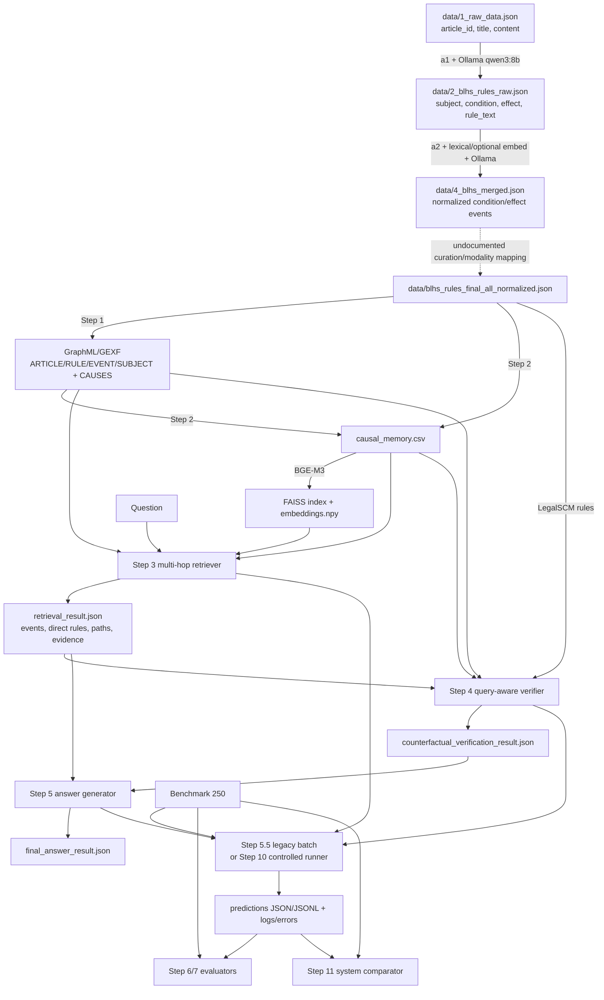

# Phân tích toàn diện mã nguồn CausalRAG / LegalSCM-RAG

> **Repo:** `/Users/nhungnguyen/Documents/cao_hoc/do_an/causal_rag`  
> **Revision đã khảo sát:** `b92da86d7fe441d2fd724c0184773b486d3a97f8` (`main`, commit `b92da86`, 2026-10-06)  
> **Phạm vi:** chỉ đọc; không sửa mã nguồn, không gọi API/model, không chạy pipeline đầy đủ.  
> **Cách dẫn chứng:** mọi đường dẫn dưới đây tương đối với thư mục gốc repo, trừ khi ghi rõ khác.

## Tóm tắt trả lời

Repo hiện thực một hệ thống hỏi đáp pháp luật hình sự Việt Nam nhiều bước, có tên trong paper là **LegalSCM-RAG**. Chuỗi chính là: văn bản Bộ luật Hình sự → trích xuất quy tắc điều kiện–hệ quả bằng LLM → chuẩn hóa sự kiện → đồ thị pháp luật nhân quả → bộ nhớ vector BGE-M3/FAISS → truy hồi semantic + mở rộng graph nhiều hop → xác minh query-aware bằng mô hình quy tắc ba giá trị LegalSCM hoặc node-deletion ablation → sinh câu trả lời có căn cứ → đánh giá và so sánh baseline. Mục tiêu thực tế không phải khám phá nhân quả từ dữ liệu quan sát, mà là suy luận quy phạm tất định trên các quy tắc đã mã hóa; chính mã nguồn cũng nói rõ đây là “normative three-valued structural rule model, not causal discovery” [`causal_core/legal_scm.py:8-13`].

Kiến trúc tổng thể rõ, nhiều artifact có provenance ở cấp rule/article, tài nguyên retrieval được kiểm tra khá chặt, Step 4 phân biệt đúng về mặt khái niệm giữa xóa node và `do()` intervention, còn runner thí nghiệm mới (`10_generate_system_baselines.py`) và comparator (`11_compare_system_baselines.py`) có nhiều biện pháp kiểm soát công bằng, audit và kiểm định thống kê tốt. Artifact hiện có báo cáo Full LegalSCM đạt Decision Accuracy 96,80%, cao hơn Causal Path RAG 88,80%; tuy nhiên Answer F1 chỉ 37,60% so với 37,27% và khác biệt answer/citation không có ý nghĩa thống kê [`evaluation_results/system_level_comparison_v2/system_comparison_summary.md:11-16`, `:34-53`].

Các kết luận quan trọng nhất:

1. **Rủi ro đúng đắn pháp lý cao:** pipeline sản xuất đã hợp nhất modality “có thể được” và “được” vào cùng event, dù normalizer ban đầu yêu cầu không gộp khi tính khả năng có ý nghĩa [`a2_normalize_events_fixed.py:47-51`]. Modality được lưu ở field phụ nhưng adapter LegalSCM biến cả condition/effect thành literal `TRUE`; engine không dùng modality khi kích hoạt rule [`causal_core/schema.py:601-615`, `causal_core/legal_scm.py:597-646`]. Benchmark đầu tiên vì vậy nối “có thể được miễn phần hình phạt còn lại” thành điều kiện “được miễn phần hình phạt còn lại” để suy ra hệ quả chắc chắn [`data/blhs_multihop_benchmark_250.json:125-170`, `:225-237`]. Đây là suy diễn từ khả năng sang sự kiện thực tế và cần được sửa trước khi coi graph là công cụ suy luận pháp lý đáng tin cậy.
2. **Kết quả hiện tại chủ yếu là internal validity:** toàn bộ câu hỏi được dựng từ chính node/cạnh của graph, benchmark tự ghi rằng cần rà soát thủ công trước khi làm gold [`data/blhs_multihop_benchmark_250.json:37-43`]. Paper cũng thừa nhận câu hỏi và graph cùng nguồn, nên thí nghiệm chủ yếu đo tính hợp lệ nội tại [`paper/vi/5_experimental_setup.tex:11-18`]. Không thể suy từ 96,80% sang chất lượng trên câu hỏi pháp lý tự nhiên ngoài graph.
3. **Không tái lập được data-preparation từ repo:** mặc định của `a1_extract_rules.py` trỏ tới `data/1_blhs_articles_parsed.json`, mặc định của `a2_normalize_events_fixed.py` trỏ tới `data/2_blhs_rules_raw.json`/`data/4_blhs_merged.json`, nhưng các file này không có. Step 1 lại dùng `data/blhs_rules_final_all_normalized.json`, trong khi không có script ghi lại bước curated/modality mapping để biến output của a2 thành file này [`a1_extract_rules.py:13-16`, `a2_normalize_events_fixed.py:17-21`, `1_build_legal_causal_graph.py:20-24`].
4. **Runner cũ 5.5 có thể làm hỏng thí nghiệm khi resume:** README hướng dẫn chạy 5 mẫu bằng provider `extractive`, rồi chạy cùng output bằng Ollama với `--resume` [`readme.md:60-71`]. Runner chỉ nạp prediction cũ và bỏ qua mọi ID đã có, không kiểm fingerprint [`5_5_generate_pipeline_predictions.py:1729-1733`, `:1777-1781`], nên file cuối có thể trộn extractive và Qwen. Runner mới Step 10 đã giảm rủi ro này, nhưng fingerprint vẫn chưa bao gồm hash dữ liệu, model digest, source commit hay prompt/source hash.
5. **Lộ bí mật ở runner 5.5:** script nhận `--api-key` [`5_5_generate_pipeline_predictions.py:1545-1548`] rồi ghi toàn bộ `vars(args)` vào run log [`5_5_generate_pipeline_predictions.py:1663-1688`]. Nếu truyền key qua CLI, key được lưu plaintext.
6. **Thiếu nền tảng kỹ nghệ:** không có `requirements.txt`, `pyproject.toml`, lockfile, `environment.yml`, `.gitignore`, test tự động hay CI. `test.ipynb` chỉ là notebook xuất CSV, còn tham chiếu một file không có [`test.ipynb:13-16`, `:43-77`]. Môi trường hiện tại là Python 3.9.6, có `requests/networkx/pandas/numpy` nhưng thiếu `faiss`, `sentence_transformers`, `rouge_score`, `bert_score`, nên không thể chạy pipeline tại máy này theo trạng thái hiện có.
7. **Nút thắt chính hiện tại là path ranking, không phải path retrieval:** paper báo Top-1 Exact Path 38,56% nhưng Oracle Exact Path 75,42% [`paper/vi/6_results.tex:107-111`]. Full LegalSCM chậm hơn khoảng 66% và không có trường hợp cải thiện riêng nào đến từ route `do()`; 23 cải thiện chỉ-Full đến từ factual validation/direct-edge route [`paper/vi/6_results.tex:90-95`, `:113-114`].

**Kết luận ngắn:** đây là một prototype nghiên cứu có ý tưởng và audit tốt, đủ để tiếp tục phát triển, nhưng chưa nên dùng như hệ thống tư vấn pháp lý hoặc coi kết quả hiện tại là bằng chứng ngoại suy. Ưu tiên số một là sửa semantics modality/subject/điều kiện, khóa chặt provenance và resume, sau đó xây benchmark chuyên gia độc lập cùng test suite.

---

## 1. Phạm vi khảo sát và kiểm tra đã thực hiện

### Mã nguồn đã đọc

- Tiền xử lý: `a1_extract_rules.py`, `a2_normalize_events_fixed.py`.
- Pipeline: `1_build_legal_causal_graph.py`, `2_build_causal_memory.py`, `3_multi_hop_causal_retriever.py`, `4_counterfactual_verification.py`, `5_generate_final_answer.py`, `5_5_generate_pipeline_predictions.py`, `6_run_evaluation_pipeline.py`, `7_compute_evaluation_metrics.py`, `8_generate_llm_only_predictions.py`, `9_generate_vanilla_rag_predictions.py`, `10_generate_system_baselines.py`, `11_compare_system_baselines.py`.
- Core: `causal_core/schema.py`, `causal_core/legal_scm.py`, `causal_core/__init__.py`.
- Hỗ trợ: `print_long_causal_chains.py`, `test.ipynb`, `readme.md`.
- Tài liệu phương pháp/kết quả: `paper/vi/3_problem_formulation.tex`, `4_legalSCM_RAG.tex`, `5_experimental_setup.tex`, `6_results.tex`, `7_conclusion.tex`.
- Schema/mẫu artifact: phần đầu của `data/1_raw_data.json`, `data/blhs_rules_final_all_normalized.json`, `data/blhs_multihop_benchmark_250.json`, `data/causal_memory.csv`; toàn bộ/đoạn cần thiết của graph stats, run logs, evaluation summaries và system comparison report. Không nạp toàn bộ các JSON 12–17 MB chỉ để đọc nội dung.

### Kiểm tra nhẹ, không làm thay đổi repo

- Dùng `ast.parse` đọc và parse thành công **18 file Python**; không phát hiện syntax error.
- Smoke test thuần bộ nhớ cho `LegalSCM` với chuỗi tổng hợp `A→B→C`: factual outcome `C=true`, hội tụ sau 3 vòng; `do(B=false)` cho `C=false`, status `NECESSARY`. Chạy với `PYTHONDONTWRITEBYTECODE=1`.
- Kiểm tra dependency bằng `importlib.util.find_spec`, không import model nặng.
- Kiểm tra Git trước khi ghi báo cáo: worktree sạch, branch `main`, revision nêu ở đầu báo cáo.
- Không chạy `py_compile` vì lệnh này có thể tạo `__pycache__`; không gọi Ollama, Hugging Face, OpenAI hay Gemini; không chạy toàn bộ benchmark.

### Kích thước artifact chính đo được

| Artifact | Kích thước xấp xỉ |
|---|---:|
| `data/1_raw_data.json` | 0,75 MB |
| `data/blhs_rules_final_all_normalized.json` | 12,26 MB |
| `data/legal_causal_knowledge_graph.graphml` | 14,49 MB |
| `data/causal_memory.csv` | 17,12 MB |
| `data/causal_memory.index` | 19,24 MB |
| `data/causal_memory_embeddings.npy` | 19,24 MB |
| `data/blhs_multihop_benchmark_250.json` | 1,92 MB |

Chỉ riêng bộ rules/graph/memory/index/embeddings đã khoảng 82 MB và đang được quản lý trực tiếp trong Git; index và `.npy` gần như nhân đôi cùng ma trận vector.

---

## 2. Mục tiêu hệ thống suy ra từ code

Hệ thống giải bài toán QA pháp luật nhiều bước trên Bộ luật Hình sự Việt Nam (BLHS): tìm các quy tắc liên quan, nối condition/effect qua event chuẩn hóa thành một đường suy luận, xác minh claim của câu hỏi, rồi sinh câu trả lời và trích dẫn điều luật. Đầu ra logic có ba nhãn: `SUPPORTED`, `REJECT_DIRECT_CLAIM`, `UNCERTAIN` [`4_counterfactual_verification.py:284-314`, `5_generate_final_answer.py:60-75`].

Có ba lớp mục tiêu:

1. **Knowledge construction:** biến điều luật thành rule có cấu trúc `condition → effect`, chuẩn hóa event và dựng heterogeneous graph gồm `ARTICLE`, `RULE`, `EVENT`, `SUBJECT` với các cạnh `HAS_RULE`, `HAS_SUBJECT`, `HAS_CONDITION`, `HAS_EFFECT`, `CAUSES` [`1_build_legal_causal_graph.py:505-775`].
2. **Retrieval + reasoning:** dùng BGE-M3/FAISS tìm event/rule seed, mở rộng graph tối đa N hop, xếp hạng path/rule, rồi chạy factual/counterfactual verification [`3_multi_hop_causal_retriever.py:590-1822`, `4_counterfactual_verification.py:3409-3729`].
3. **Controlled evaluation:** so LLM-only, Vanilla RAG, Causal Path RAG và Full LegalSCM dưới cùng generation contract; tính metric retrieval/path/decision/answer/citation và paired statistical tests [`10_generate_system_baselines.py:1-31`, `11_compare_system_baselines.py:1-24`, `:710-899`].

LegalSCM không ước lượng hiệu ứng nhân quả từ dữ liệu. Nó là chương trình luật ba giá trị với fixed-point semantics, hỗ trợ `do(event=false/true)` bằng cách cố định event và vô hiệu hóa mọi rule tạo event đó [`causal_core/legal_scm.py:339-386`, `:923-1054`]. Paper mô tả đúng giới hạn này và không nên diễn giải các cạnh `CAUSES` như quan hệ nhân quả thực nghiệm ngoài thế giới [`paper/vi/7_conclusion.tex:34-44`].

---

## 3. Kiến trúc và luồng dữ liệu end-to-end



### Hợp đồng dữ liệu chính

- **Raw article:** `article_id`, `article_title`, `content` [`data/1_raw_data.json:1-14`]. Đếm nhẹ cho thấy 406 record duy nhất, ID 1–426 và thiếu 20 ID; graph cuối chỉ có 395 ARTICLE node [`data/legal_causal_graph_stats.json:7-14`], tức 11 raw article khác không có node rule/article trong graph. Chưa xác minh đó là chủ ý hay thất thoát extraction.
- **Normalized rule:** các field cốt lõi `index`, `article_id`, `legal_subject`, `condition`, `effect`, `condition_event`, `effect_event`; production data còn có names, source text, quality, scope, original event, modality và normalization version [`data/blhs_rules_final_all_normalized.json:2-24`, `causal_core/schema.py:16-40`].
- **Graph:** 5.134 node, 14.420 multi-edge: 395 ARTICLE, 2.884 RULE, 1.814 EVENT, 41 SUBJECT; mỗi loại cạnh có 2.884 instance. Event-level DiGraph sau gộp có 2.122 cặp causal duy nhất, 14 bridge event, 112 chuỗi hai hop, là DAG và có 248 weak components [`data/legal_causal_graph_stats.json:2-30`, `:186-189`].
- **Memory:** 2.884 RULE memory + 1.814 EVENT memory = 4.698 vector. `memory_id` bắt buộc trùng vị trí vector trong FAISS/NumPy [`2_build_causal_memory.py:558-659`, `3_multi_hop_causal_retriever.py:361-409`].
- **Benchmark:** 250 câu; 236 có linear gold path; 230 nhãn `SUPPORTED`, 20 `REJECT_DIRECT_CLAIM`, không có gold `UNCERTAIN` [`data/blhs_multihop_benchmark_250.json:97-120`].

### Input/output cụ thể từng bước

| Bước | Input | Output |
|---|---|---|
| `a1_extract_rules.py` | JSON array article (`article_id`, `article_title`, `content`) + Ollama | Raw rule JSON; `<stem>_state.json`; thư mục errors/empty response |
| `a2_normalize_events_fixed.py` | Raw rules + optional catalog + Ollama; optional embedding endpoint | Merged normalized rules, event catalog, state và error JSON |
| `1_build_legal_causal_graph.py` | Normalized rules JSON/CSV | GraphML, GEXF, graph stats JSON, two-hop chains CSV |
| `2_build_causal_memory.py` | Normalized rules + GraphML + SentenceTransformer | `causal_memory.csv`, FAISS `IndexFlatIP`, normalized embedding `.npy` |
| `3_multi_hop_causal_retriever.py` | Query + graph + memory + index + embeddings + same embedding model | `retrieval_result.json` |
| `4_counterfactual_verification.py` | Retrieval result + graph + memory + normalized rules | Verification JSON với path/evidence statuses, final decision, query analysis và audit |
| `5_generate_final_answer.py` | Step 3 + Step 4 JSON; provider | Answer JSON, selected evidence/paths, citations, generation metadata |
| `5_5_generate_pipeline_predictions.py` | Benchmark + shared resources + dynamic Step 3/4/5 modules | Prediction JSON/JSONL, errors, run log, optional per-sample intermediates |
| `6_run_evaluation_pipeline.py` | Benchmark + predictions hoặc oracle | Tổng quan JSON, per-question CSV, summary, errors, normalized predictions |
| `7_compute_evaluation_metrics.py` | Benchmark + predictions | Detailed metrics JSON/CSV, confusion matrix, grouped metrics, summary |
| `8_generate_llm_only_predictions.py` | Chỉ ID/question benchmark + LLM | Legacy LLM-only prediction artifacts |
| `9_generate_vanilla_rag_predictions.py` | Raw articles + questions + BGE-M3 + Ollama | Article index/meta và Vanilla RAG prediction artifacts |
| `10_generate_system_baselines.py` | Benchmark và resource theo mode | Controlled prediction/checkpoint/error/run-log cho từng mode |
| `11_compare_system_baselines.py` | ≥2 prediction files + benchmark + Step 7 evaluator | Cross-system report, per-sample CSV, significance CSV, Markdown summary |

---

## 4. Trách nhiệm, thuật toán và phụ thuộc của từng script/module

### `a1_extract_rules.py` — trích xuất rule thô

- Gửi từng điều luật tới Ollama `/api/generate`, mặc định `qwen3:8b`, `temperature=0`, JSON schema có bốn field `legal_subject`, `condition`, `effect`, `rule_text` [`a1_extract_rules.py:13-17`, `:434-468`].
- Parser loại `<think>`, code fence, thử parse toàn response rồi object/array cân bằng; chấp nhận alias key để tăng độ bền [`a1_extract_rules.py:281-410`].
- Chuẩn hóa text, loại rule thiếu condition/effect, deduplicate theo article/subject/condition/effect, reindex; retry mặc định 3 lần [`a1_extract_rules.py:470-576`].
- Atomic JSON save và checkpoint sau từng article; lưu raw response/error/empty riêng [`a1_extract_rules.py:578-674`, `:677-934`].
- Phụ thuộc: `requests`, Ollama. Không có seed/model digest/prompt version trong output.

### `a2_normalize_events_fixed.py` — canonical event catalog

- Chuẩn hóa condition và effect độc lập, có kiểm tra role/type và mặc định cấm self-loop [`a2_normalize_events_fixed.py:161-266`, `:442-488`, `:872-1026`].
- Candidate retrieval dùng điểm lexical `0,45*Jaccard + 0,35*SequenceMatcher + 0,20*containment`; nếu có embedding thì điểm cuối `0,75*cosine + 0,25*lexical` [`a2_normalize_events_fixed.py:321-348`, `:490-568`].
- Exact alias có thể bypass LLM. Nếu không, Ollama chọn `USE_EXISTING` hoặc `CREATE_NEW`; chỉ dùng existing khi candidate hợp lệ và score ≥0,60. Catalog lưu aliases, occurrences, source article/rule [`a2_normalize_events_fixed.py:570-693`, `:696-1026`].
- Atomic save sau mỗi rule, resume bằng hash của index/article/condition/effect [`a2_normalize_events_fixed.py:1081-1144`, `:1147-1377`].
- Phụ thuộc: `requests`, optional Ollama embedding model. Thuật toán tuần tự và order-dependent vì catalog lớn dần theo thứ tự rule.

### `1_build_legal_causal_graph.py` — dựng graph

- Đọc JSON/CSV bằng pandas; bắt buộc sáu field lõi và bổ sung default cho optional metadata [`1_build_legal_causal_graph.py:187-267`].
- Với mỗi rule, tạo ARTICLE/RULE/EVENT/SUBJECT node; condition/effect dùng cùng namespace canonical, nhờ đó effect rule trước có thể nối condition rule sau [`1_build_legal_causal_graph.py:293-502`].
- Tạo `condition EVENT --CAUSES--> effect EVENT`, giữ provenance rule/article/subject/text/modality trên edge [`1_build_legal_causal_graph.py:690-758`].
- Gộp parallel causal edges thành event-level `DiGraph`, trích `A→B→C`, tính DAG/components/bridge stats, sanitize primitive types trước GraphML/GEXF export [`1_build_legal_causal_graph.py:779-1104`, `:1108-1192`].
- Phụ thuộc: `networkx`, `pandas`.

### `2_build_causal_memory.py` — vector memory

- Tạo một embedding document cho mỗi RULE và mỗi EVENT; rule text chứa subject, condition/effect, canonical event/name/modality, article và rule text [`2_build_causal_memory.py:99-173`, `:237-403`].
- Đọc EVENT node từ GraphML, phân loại `CONDITION`, `EFFECT`, `BRIDGE`; ghép với RULE memory và gán `memory_id` theo thứ tự [`2_build_causal_memory.py:406-586`].
- Encode bằng `SentenceTransformer("BAAI/bge-m3")`, normalize vector, xây `faiss.IndexFlatIP` tương đương cosine exact search [`2_build_causal_memory.py:28-30`, `:662-708`].
- Kiểm graph-node consistency và verify CSV/index/`.npy` shape sau khi ghi [`2_build_causal_memory.py:589-659`, `:742-807`].
- `--rule-only` vẫn load graph trước khi rẽ nhánh [`2_build_causal_memory.py:856-913`] và output này không dùng được cho Step 3 vì Step 3 bắt buộc có EVENT memory [`3_multi_hop_causal_retriever.py:391-404`].

### `3_multi_hop_causal_retriever.py` — semantic retrieval + graph expansion

- `CausalResourceStore` nạp/kiểm graph, memory, FAISS, embeddings và model; xây lookup tables và event-only graph [`3_multi_hop_causal_retriever.py:246-588`].
- Stage 1: search combined FAISS pool; nếu chưa đủ event/rule thì dot-product trực tiếp trên subset vector để bảo đảm recall [`3_multi_hop_causal_retriever.py:704-882`].
- Stage 2: heuristic hướng forward/backward/both từ từ khóa query; bounded BFS mở rộng tối đa `max_hops`, ưu tiên edge support và thưởng path đủ hop/bridge event [`3_multi_hop_causal_retriever.py:596-701`, `:883-1195`]. Candidate pool bị chặn ở `max_paths*20` [`3_multi_hop_causal_retriever.py:978-986`].
- Stage 3/4: gom rule chạm seed/path/direct hit, rồi rerank với trọng số semantic 0,32; graph path 0,36; seed 0,10; direct 0,07; path priority 0,15 [`3_multi_hop_causal_retriever.py:1202-1468`].
- Output gồm events, direct rules, toàn bộ candidate paths, final evidence và statistics [`3_multi_hop_causal_retriever.py:1636-1822`].

### `causal_core/schema.py` — schema và adapter

- `LegacyLegalRule`/`LegalEvent` cố bảo toàn missing field, explicit null và unknown future fields, có validation [`causal_core/schema.py:174-326`, `:329-430`].
- Canonical `CausalRule` hỗ trợ nhiều conjunctive conditions, exceptions, positive/negative literal và metadata; legacy rule được chuyển thành đúng một positive condition, không exception, một positive effect [`causal_core/schema.py:458-698`].
- `EventState` là `TRUE/FALSE/UNKNOWN`; `EventType` đồng bộ với a2 [`causal_core/schema.py:55-113`].

### `causal_core/legal_scm.py` — fixed-point LegalSCM

- Lập chỉ mục rule theo effect, hỗ trợ sparse incidence encoding để audit/paper nhưng runtime vẫn symbolic [`causal_core/legal_scm.py:339-505`].
- Mỗi vòng đánh giá toàn bộ rule: đủ conditions, không exception, effect không bị intervention thì activate; sau đó derive support mới tới fixed point [`causal_core/legal_scm.py:551-677`, `:679-866`].
- Mặc định closed-world cho endogenous event: nếu không rule nào sinh ra thì `FALSE`; root event chưa cấp context là `UNKNOWN` [`causal_core/legal_scm.py:8-13`, `:669-676`].
- `counterfactual()` chạy factual và intervened worlds, chặn can thiệp trực tiếp outcome, vô hiệu hóa rule tạo treatment, rồi phân loại `NECESSARY`, `NON_NECESSARY`, `SUFFICIENT`, `NO_EFFECT`, `INDETERMINATE` [`causal_core/legal_scm.py:868-1054`].
- `causal_core/__init__.py` chỉ re-export public API [`causal_core/__init__.py:1-43`].

### `4_counterfactual_verification.py` — verifier query-aware

- Nạp graph/memory/retrieval; optional load toàn bộ normalized rules thành `LegalSCM`, cache theo path+mtime trong một process [`4_counterfactual_verification.py:555-720`].
- **Topology route:** chuẩn hóa path, xác nhận các cạnh CAUSES. Node-deletion dùng `nx.all_simple_paths` trong `G[V-{M}]`, phân loại mediator necessary/non-necessary/partial theo alternative reachability score [`4_counterfactual_verification.py:1522-1882`].
- **Structural route:** trước hết factual inference với context duy nhất `{seed_event_id: TRUE}`; yêu cầu outcome true, mọi hop có activated rule và không conflict. Chỉ explicit intervention/necessity claim mới gọi `scm.counterfactual()` [`4_counterfactual_verification.py:1885-2390`, đặc biệt `:1956-2023`].
- **Query-aware route:** regex/từ khóa phân claim thành standard, direct, remove-remains/disappears, necessary/omittable; direct claim ground hai endpoint và kiểm cạnh; intervention claim ground mediator ≥0,80 và đọc world state [`4_counterfactual_verification.py:2620-3331`].
- Mặc định chỉ path 0 chạy structural verification; path phụ topology-only. Primary selector giữ tuyệt đối Step-3 path 0 trừ khi bật switch [`4_counterfactual_verification.py:2523-2617`, `:3513-3537`].
- Evidence được chấm bằng path support, counterfactual support, semantic và graph; chia KEEP/UNCERTAIN/REMOVE [`4_counterfactual_verification.py:2416-2520`].

### `5_generate_final_answer.py` — answer generation

- Nạp Step 3/4, suy `answer_intent` từ query: final outcome, initial cause, bridge, chain, yes/no, branch, convergence, claim verification [`5_generate_final_answer.py:256-344`, `:401-650`].
- Chọn primary path/evidence theo thứ tự causal; bổ sung verified/uncertain evidence theo score [`5_generate_final_answer.py:653-1141`].
- Prompt buộc bám final decision/evidence/path và citation `[E#]`; hỗ trợ Ollama, OpenAI-compatible, Gemini, hoặc deterministic extractive provider [`5_generate_final_answer.py:1144-1877`].
- Validator hiện chỉ sửa citation ID và chèn citation khi thiếu; không kiểm semantic answer/decision [`5_generate_final_answer.py:1921-1986`].
- LLM lỗi có thể fallback extractive nếu không bật `--no-extractive-fallback` [`5_generate_final_answer.py:1988-2208`].

### `5_5_generate_pipeline_predictions.py` — legacy batch runner

- Dynamic-import Step 3/4/5; khởi tạo retriever một lần, nhưng dựng lại Step-4 store cho từng sample [`5_5_generate_pipeline_predictions.py:1030-1407`].
- Ghi per-sample retrieval/verification/answer intermediates vì Step 4/5 trao đổi bằng file; checkpoint JSONL và JSON, tiếp tục khi lỗi trừ `--fail-fast` [`5_5_generate_pipeline_predictions.py:1190-1398`, `:1695-1944`].
- Đây là runner thuận tiện cho diagnostic, nhưng không nên dùng cho bảng thí nghiệm chính vì resume không có contract fingerprint, có extractive fallback mặc định và có bug ghi API key.

### `6_run_evaluation_pipeline.py` — evaluator tổng quan cũ

- Chuẩn hóa nhiều schema prediction linh hoạt; tính retrieval Hit/Recall/Precision@K, MRR/MAP, exact/hop/path F1, decision, token/ROUGE-L, optional BERTScore và citation [`6_run_evaluation_pipeline.py:131-419`, `:422-1072`].
- Missing prediction được đưa vào với output rỗng, nên metric nhận 0; `--strict` chỉ chặn thiếu prediction, không chặn extra IDs [`6_run_evaluation_pipeline.py:1075-1097`, `:1637-1645`].
- Default benchmark là file `_updated.json` không tồn tại [`6_run_evaluation_pipeline.py:1532-1543`].

### `7_compute_evaluation_metrics.py` — evaluator chi tiết hiện dùng

- Chuẩn hóa benchmark/prediction hiện tại, phân biệt top-1 path và oracle candidate, tính rule/event/article/path/decision/answer/citation metrics, confusion matrix và breakdown [`7_compute_evaluation_metrics.py:790-1380`, `:1409-1644`].
- Đúng khi ghi rõ oracle chỉ là diagnostic, không thay top-1 [`7_compute_evaluation_metrics.py:2184-2226`].
- Nhưng aggregate Step 7 lọc `successful_rows` rồi tính hầu hết quality metric chỉ trên subset thành công [`7_compute_evaluation_metrics.py:1798-1805`, `:1813-1980`], nên có thể làm đẹp số nếu pipeline lỗi. Step 11 đã sửa bằng chính sách failures score zero.

### `8_generate_llm_only_predictions.py` và `9_generate_vanilla_rag_predictions.py`

- Step 8 chỉ gửi question cho Ollama/OpenAI/Gemini, không đọc gold/retrieval; output compatible Step 7 [`8_generate_llm_only_predictions.py:166-249`, `:504-722`]. Resume không có fingerprint.
- Step 9 index raw article bằng BGE-M3/FAISS, lấy top-5 rồi dùng Ollama; không graph/rule/verification. Cache article index có fingerprint corpus text + model name [`9_generate_vanilla_rag_predictions.py:110-239`]. Model revision vẫn không pin.
- Hai script là baseline đời trước; README hiện khuyến nghị Step 10 cho thí nghiệm chính [`readme.md:136-165`].

### `10_generate_system_baselines.py` — controlled experiment runner

- Bốn mode dùng cùng system prompt, parser, JSON schema, Ollama settings, seed, context budget; chỉ context/verification khác [`10_generate_system_baselines.py:1-31`, `:425-598`, `:601-708`].
- Full mode chạy Step 3 → Step 4, rồi commit gate kiểm path, score, fallback, grounding, hop coverage, conflict và world state. Gate fail quay về đúng Step-3 context thay vì biến topology fallback thành SCM authority [`10_generate_system_baselines.py:972-1290`, `:1580-1750`].
- Không cho overwrite output ngầm; resume kiểm configuration fingerprint; output ghi audit route/abstention/commit/fallback/intervention [`10_generate_system_baselines.py:1958-2168`, `:2467-2635`].
- Đây là đường chạy nên dùng cho kết quả paper, nhưng fingerprint chỉ hash một subset tham số, không hash input/model/source.

### `11_compare_system_baselines.py` — comparator

- Kiểm generation contract, applicability của metric, completeness và common-sample alignment [`11_compare_system_baselines.py:181-307`, `:997-1137`].
- Missing/failed prediction nhận 0 trên shared end-to-end metrics; component không tồn tại ghi `N/A`, không ghi 0 [`11_compare_system_baselines.py:310-517`, `:581-707`].
- Dùng bootstrap CI, exact McNemar, paired sign-randomization và Holm correction [`11_compare_system_baselines.py:710-899`].
- Có thể bypass contract check bằng `--allow-contract-mismatch`; artifact hiện tại dùng tùy chọn này để đưa forced-binary sensitivity run vào cùng report và ghi warning [`evaluation_results/system_level_comparison_v2/system_comparison_summary.md:55-57`].

---

## 5. Cách chạy đúng thứ tự

### 5.1. Điều kiện môi trường

Suy ra từ imports và code, tối thiểu cần:

- Python tương thích (repo/notebook từng dùng Python 3.9.x; bytecode 3.9 và 3.12 cùng bị commit).
- `requests`, `networkx`, `pandas`, `numpy`, `sentence-transformers`, FAISS Python (`faiss-cpu` hoặc build phù hợp), optional `rouge-score`, `bert-score`.
- Ollama đang chạy tại mặc định `http://localhost:11434`; model `qwen3:8b` đã pull.
- BGE-M3 `BAAI/bge-m3` tải qua SentenceTransformers/Hugging Face ở lần đầu.
- Nếu dùng Step 5/8 với provider ngoài: `OPENAI_API_KEY` hoặc `GEMINI_API_KEY`; tránh `--api-key` trên runner 5.5 cho đến khi sửa secret logging.
- Dung lượng RAM/GPU/VRAM chưa được tài liệu hóa. `num_ctx=32768`, Qwen3-8B và BGE-M3 có thể cần tài nguyên đáng kể.

README cũ giả định SSH tới server, activate `conda activate nhungnt`, rồi `ollama serve` [`readme.md:1-5`], nhưng repo không có environment definition để tái tạo env đó.

### 5.2. Tái dựng từ raw data — chỉ tái dựng được một phần

Mặc định a1 trỏ tới file thiếu, nhưng `data/1_raw_data.json` có đúng ba field a1 đọc. Giả định hợp lý là truyền explicit input này:

```bash
python a1_extract_rules.py \
  --input data/1_raw_data.json \
  --output data/2_blhs_rules_raw.json \
  --model qwen3:8b \
  --resume

python a2_normalize_events_fixed.py \
  --input data/2_blhs_rules_raw.json \
  --output data/4_blhs_merged.json \
  --catalog data/3_event_catalog.json \
  --model qwen3:8b \
  --resume
```

Nếu muốn semantic candidate ranking ở a2, thêm `--embedding-model <ollama-embedding-model>`; mặc định chỉ lexical. Lần chạy sạch nên dùng `--overwrite`, các lần tiếp theo dùng `--resume`, không trộn tùy tiện.

**Giới hạn:** hai lệnh trên không tái tạo chính xác `data/blhs_rules_final_all_normalized.json`: production file có `quality_status`, `source_scope`, original event, modality và normalization version, trong khi a2 chỉ gán event/name/normalization metadata [`a2_normalize_events_fixed.py:1314-1323`]. Bước curation/mapping nằm ngoài code được commit. Có thể dùng `data/4_blhs_merged.json` trực tiếp làm input Step 1 cho một pipeline cơ bản, nhưng kết quả sẽ không khớp artifact/paper hiện tại.

### 5.3. Xây graph và memory hiện tại

Để tái dùng production normalized data đã commit:

```bash
python 1_build_legal_causal_graph.py \
  --input data/blhs_rules_final_all_normalized.json

python 2_build_causal_memory.py \
  --input data/blhs_rules_final_all_normalized.json \
  --graph data/legal_causal_knowledge_graph.graphml \
  --model BAAI/bge-m3
```

Không dùng `--rule-only` nếu sẽ chạy Step 3, vì retriever bắt buộc EVENT memory.

### 5.4. Chạy một câu thủ công

```bash
python 3_multi_hop_causal_retriever.py \
  "Người phạm tội chưa đạt phải chịu trách nhiệm hình sự như thế nào?" \
  --max-hops 2 \
  --event-top-k 8 \
  --final-top-k 12

python 4_counterfactual_verification.py \
  --retrieval-result data/retrieval_result.json \
  --rules data/blhs_rules_final_all_normalized.json \
  --counterfactual-mode structural_scm

python 5_generate_final_answer.py \
  --retrieval-result data/retrieval_result.json \
  --verification-result data/counterfactual_verification_result.json \
  --provider ollama \
  --model qwen3:8b \
  --no-extractive-fallback
```

Step 4 chỉ chạy hard `do()` nếu raw query chứa explicit remove/necessity intent; câu standard chỉ factual validate, direct claim chỉ topology-ground endpoints [`4_counterfactual_verification.py:3450-3498`].

### 5.5. Chạy batch diagnostic cũ

Có thể dùng Step 5.5, nhưng **chỉ dùng output mới cho một cấu hình duy nhất**; không làm theo chuỗi extractive rồi Ollama `--resume` trong README:

```bash
python 5_5_generate_pipeline_predictions.py \
  --benchmark data/blhs_multihop_benchmark_250.json \
  --counterfactual-mode structural_scm \
  --rules data/blhs_rules_final_all_normalized.json \
  --provider extractive \
  --output data/diagnostic_predictions.json \
  --jsonl-output data/diagnostic_predictions.jsonl \
  --errors-output data/diagnostic_errors.json \
  --run-log data/diagnostic_run_log.json \
  --work-dir data/diagnostic_intermediate
```

Không truyền key thật qua `--api-key` cho đến khi run-log được redaction.

### 5.6. Chạy thí nghiệm chính có kiểm soát

Runner đúng cho bảng paper là Step 10:

```bash
python 10_generate_system_baselines.py --mode llm_only --model qwen3:8b --resume
python 10_generate_system_baselines.py --mode vanilla_rag --model qwen3:8b --resume
python 10_generate_system_baselines.py --mode causal_path_rag --model qwen3:8b --resume
python 10_generate_system_baselines.py --mode full_legal_scm --model qwen3:8b --resume
```

- Dùng `--overwrite` cho run mới có chủ đích.
- Không dùng `--allow-scm-fallback` cho bảng chính.
- Nên đặt `--minimum-structural-interventions 1` hoặc số kỳ vọng để tránh một run “Full” không thực thi `do()` nào nhưng vẫn được coi là hoàn tất; mặc định hiện là 0 [`10_generate_system_baselines.py:109-111`, `:2277-2286`, `:2588-2620`].

So sánh:

```bash
python 11_compare_system_baselines.py \
  --predictions \
    llm_only=data/baselines/system_level/llm_only_qwen3_8b_predictions.json \
    vanilla_rag=data/baselines/system_level/vanilla_rag_qwen3_8b_predictions.json \
    causal_path_rag=data/baselines/system_level/causal_path_rag_qwen3_8b_predictions.json \
    full_legal_scm=data/baselines/system_level/full_legal_scm_qwen3_8b_predictions.json \
  --reference full_legal_scm \
  --require-complete-success
```

Detailed diagnostic cho một prediction file:

```bash
python 7_compute_evaluation_metrics.py \
  --benchmark data/blhs_multihop_benchmark_250.json \
  --predictions <prediction.json> \
  --output-dir <evaluation_dir> \
  --strict
```

Nếu dùng Step 6, phải truyền benchmark explicit vì default `_updated.json` không có:

```bash
python 6_run_evaluation_pipeline.py \
  --benchmark data/blhs_multihop_benchmark_250.json \
  --predictions <prediction.json> \
  --output-dir <evaluation_dir> \
  --strict
```

---

## 6. Đánh giá chất lượng code và hệ thống

### 6.1. Thiết kế và khả năng bảo trì

**Tích cực:** tên stage rõ, docstring/comment dày, type hints/dataclass được dùng nhiều, public core tương đối sạch. Schema adapter có ý thức backward compatibility; Step 10/11 đã sửa nhiều vấn đề của pipeline cũ.

**Hạn chế:** kiến trúc vẫn là tập script monolithic trao đổi bằng file. Các file lớn nhất là Step 4 (3.878 dòng), Step 10 (2.635), Step 7 (2.428), Step 5 (2.356), Step 3 (2.060), Step 5.5 (1.944). Helper `safe_string`, normalize ID/decision/citation, JSON I/O, HTTP parser và benchmark loader bị copy ở nhiều file; behavior đã lệch giữa Step 6, Step 7 và Step 11. Dynamic import giúp tái sử dụng script đánh số nhưng làm type checking/test khó hơn.

### 6.2. Tái lập

Mức tái lập hiện **thấp đến trung bình**:

- Không pin dependency/Python/model revision/Ollama version.
- `qwen3:8b` và `BAAI/bge-m3` là mutable identifiers; không có Ollama digest/Hugging Face revision/hash.
- Graph/memory/index không có manifest liên kết input hash, code commit, model revision và schema version. Step 3 chỉ kiểm shape/count; nếu dùng model khác nhưng cùng dimension, query vector có thể silently không cùng không gian với index [`3_multi_hop_causal_retriever.py:357-409`].
- Step 10 fingerprint tốt hơn runner cũ nhưng `configuration_payload()` không chứa benchmark/corpus/graph/memory/index/rules path hoặc content hash, Ollama URL/digest, source revision và prompt/source hash [`10_generate_system_baselines.py:1958-1998`]. Nếu metadata cũ không có fingerprint, resume vẫn được cho phép vì chỉ compare khi `old_fingerprint` truthy [`10_generate_system_baselines.py:2485-2491`].
- Output paper/run logs chứa absolute Linux/Windows paths nhưng không ghi content hashes; không thể chứng minh artifact hiện có được tạo từ đúng revision đang đọc.

### 6.3. Hiệu năng

- A1/A2 gọi LLM tuần tự cho từng article hoặc từng phrase; a2 có thể gọi gần 2 lần/rule và rank toàn catalog, nên chi phí tăng theo số rule × số event. Embedding cache chỉ in-memory, không persist.
- Step 2 encode 4.698 record và lưu cả FAISS index lẫn `.npy` gần 19,24 MB mỗi file. `.npy` cần cho custom rerank nhưng duplication nên được quản lý bằng artifact manifest hoặc memory-map.
- Step 3 dùng exact `IndexFlatIP`, phù hợp quy mô 4.698 vector; bottleneck chính là load model và path ranking hơn là ANN.
- Step 4/runner 5.5/10 dựng lại `CounterfactualResourceStore` mỗi sample, tức đọc GraphML ~14,5 MB và memory CSV ~17,1 MB nhiều lần; chỉ `LegalSCM` rules có process cache. Đây là overhead rõ ràng.
- Artifact đo được xác nhận Full LegalSCM trung bình 3,238 giây/câu, Causal Path RAG 1,947 giây/câu, tăng khoảng 66% [`paper/vi/6_results.tex:113-114`].

### 6.4. Quản lý lỗi

**Tốt:** retry HTTP, timeout, atomic JSON temp/replace, per-sample error isolation, JSONL checkpoint, traceback, resource validation, fail-fast tùy chọn. Step 10 từ chối output tồn tại nếu không `--resume/--overwrite` [`10_generate_system_baselines.py:2473-2478`].

**Chưa tốt:** nhiều `except Exception` chuyển lỗi semantic/load thành fallback; nếu chỉ nhìn final metric có thể không biết route thực tế. Step 10 audit giảm rủi ro, nhưng Step 5.5/Step 5 cũ có thể silently fallback extractive hoặc topology. Binary index/embeddings được ghi không atomic theo bộ ba; verify chỉ chạy sau khi ghi xong, nên interruption có thể để artifact lệch.

### 6.5. Quản lý dữ liệu

- Provenance ở cấp rule/article/event khá phong phú, nhưng provenance nguồn luật tổng thể thiếu: phiên bản BLHS, ngày hiệu lực, nguồn URL, checksum, điều sửa đổi/bãi bỏ, license.
- Full article `content` được lặp trong hàng nghìn rule/memory/graph nodes, tăng kích thước và nguy cơ divergence. Nên dùng document store một bản + foreign key.
- Repo track `.DS_Store`, nhiều `__pycache__/*.pyc` cho cả CPython 3.9/3.12, index/model-derived data, reports, PDF và ZIP; không có `.gitignore` hay artifact policy.
- `causal_edges` trong benchmark metadata là 2.884 multi-edge, còn graph stats dùng cùng tên cho 2.122 unique event-pair edge [`data/blhs_multihop_benchmark_250.json:12-15`, `data/legal_causal_graph_stats.json:28-31`]. Hai số đều có thể đúng nhưng field name thiếu semantic (`causal_rule_edges` vs `unique_event_pairs`).

---

## 7. Bug, rủi ro, không nhất quán và nợ kỹ thuật

### Mức Cao

#### H-1. Mất modality tạo suy luận pháp lý không sound

- A2 nói rõ “Có thể được miễn” khác “Được miễn” khi tính khả năng quan trọng [`a2_normalize_events_fixed.py:47-51`].
- Curated production mapping lại loại tiền tố `bị/được/có thể bị/có thể được`, lưu modality riêng [`data/clean_data/bridge_events_statistics_normalized.json:2-8`]. Graph stats cho thấy cùng event mang cả `GRANTED,POSSIBLE_GRANTED` [`data/legal_causal_graph_stats.json:62-73`, `:116-117`].
- Legacy adapter giữ modality như metadata field nhưng rule activation chỉ nhìn event/state; mọi effect là `TRUE` [`causal_core/schema.py:601-615`, `causal_core/legal_scm.py:611-646`].
- Gold benchmark đã chứa chuỗi từ khả năng sang actuality [`data/blhs_multihop_benchmark_250.json:152-170`, `:225-237`].

**Tác động:** graph, benchmark và LegalSCM có thể kết luận một hệ quả chắc chắn chỉ vì luật nói cơ quan “có thể” áp dụng. Đây là lỗi semantic, không chỉ lỗi trình bày.  
**Khuyến nghị:** không merge event khác deontic/epistemic modality, hoặc đưa modality vào literal/rule operator và semantics; rebuild graph, benchmark và mọi artifact.

#### H-2. Benchmark vòng kín và chưa được expert-review

Gold question/path/answer được sinh từ graph mà hệ thống truy hồi; câu hỏi thường chứa nguyên văn canonical event name. Metadata tự yêu cầu manual review [`data/blhs_multihop_benchmark_250.json:37-43`]. Chỉ có 20 negative và không có gold uncertain [`data/blhs_multihop_benchmark_250.json:97-120`].

**Tác động:** 96,80% chủ yếu đo khả năng khôi phục cấu trúc do chính hệ thống tạo, không đo legal QA ngoài phân phối; direct-edge negative gần như kiểm đúng rule dùng để sinh nhãn.  
**Khuyến nghị:** giữ benchmark này làm unit/internal benchmark; tạo test set độc lập, câu hỏi do chuyên gia viết, split theo article/concept/time, có adversarial paraphrase, unknown/unanswerable và adjudication.

#### H-3. Data-preparation lineage bị đứt

Các default intermediate không tồn tại và không có script curation từ a2 sang production normalized file. Raw có 406 article nhưng graph chỉ có 395 ARTICLE node; không có report giải thích 11 article không đi vào graph.

**Tác động:** người khác không tái tạo graph/paper từ raw; khó audit lỗi extraction/normalization.  
**Khuyến nghị:** commit pipeline ETL đầy đủ, immutable raw manifest, curation diff/audit log, validation report và checksums.

#### H-4. Step 5.5 resume trộn cấu hình/provider

README trực tiếp tạo tình huống extractive-then-Ollama resume [`readme.md:60-71`]. Runner không lưu/so fingerprint trước skip [`5_5_generate_pipeline_predictions.py:1729-1733`, `:1777-1781`].

**Tác động:** metric có thể được tính trên một file chứa nhiều provider/model/mode mà metadata tổng không phản ánh.  
**Khuyến nghị:** deprecate Step 5.5 cho experiment; hoặc port exact fingerprint/file-exists safeguards từ Step 10, kiểm per-row contract, từ chối resume legacy metadata.

#### H-5. API key plaintext trong run log Step 5.5

`--api-key` đi thẳng vào `vars(args)` [`5_5_generate_pipeline_predictions.py:1545-1548`, `:1685-1688`].

**Tác động:** secret có thể bị commit hoặc chia sẻ cùng artifact.  
**Khuyến nghị:** bỏ CLI key khỏi serialized config, redaction mọi key/token/header, ưu tiên env/keychain; rotate ngay key nào từng dùng với runner này.

#### H-6. Không bảo đảm answer phù hợp authoritative decision

Step 5 chỉ prompt yêu cầu không trái final decision nhưng validator chỉ kiểm citation [`5_generate_final_answer.py:1150-1218`, `:1921-1986`]. Step 10 có thể override label thành authoritative nhưng giữ nguyên `generation.answer` [`10_generate_system_baselines.py:1762-1777`, `:1811-1814`]. Paper cũng ghi đây là việc tương lai [`paper/vi/7_conclusion.tex:56-60`].

**Tác động:** output có thể có `verification_decision=REJECT_DIRECT_CLAIM` nhưng câu trả lời nói “Có”, làm metric decision cao trong khi user-facing answer sai.  
**Khuyến nghị:** structured claim/answer schema; deterministic template cho three-way decision; post-validator kiểm polarity/required facts/citations và retry/fail nếu mâu thuẫn.

#### H-7. Artifact/model compatibility không được fingerprint đầy đủ

Step 2 không xuất index metadata; Step 3 chỉ kiểm count/shape và dùng model CLI độc lập. Step 10 fingerprint không hash inputs/source/model digest.

**Tác động:** silent mismatch giữa query encoder và index, hoặc resume trên graph/rules/code đã thay đổi.  
**Khuyến nghị:** một `artifact_manifest.json` chứa SHA-256 mọi input/output, schema versions, Git commit, Python/package lock hash, HF revision, Ollama digest, embedding dimension/normalization, prompt hash; mọi stage fail closed khi mismatch.

#### H-8. Semantics factual quá nghèo so với luật thật

Step 4 tạo factual context chỉ bằng `{seed_event_id: TRUE}` [`4_counterfactual_verification.py:1956-1960`]. Actual imported rule chỉ có một positive condition, không exception; paper tự xác nhận chưa đánh giá conjunction [`paper/vi/3_problem_formulation.tex:101-104`]. `legal_subject`, scope, modality và nhiều điều kiện tự nhiên không tham gia activation.

**Tác động:** rule của chủ thể/phạm vi khác có thể cùng activate qua event ID; closed-world biến thiếu cơ chế thành FALSE, làm necessity phụ thuộc mạnh vào coverage của rule base.  
**Khuyến nghị:** query grounding thành nhiều typed facts; đưa subject/jurisdiction/time/modality/exception vào literal; dùng open-world mặc định hoặc explicit negation cho dữ liệu pháp luật không đầy đủ; benchmark conjunction/exceptions.

### Mức Trung bình

#### M-1. Step 7 loại prediction lỗi khỏi quality denominator

`aggregate_group()` tạo `successful_rows` và tính retrieval/path/verification/answer/citation trên đó [`7_compute_evaluation_metrics.py:1798-1805`, `:1813-1980`].

**Tác động:** run lỗi nhiều có thể vẫn có metric đẹp. Step 11 đã xử lý đúng bằng failures score zero.  
**Khuyến nghị:** thêm `all_samples` metrics mặc định, giữ `successful_only` chỉ là diagnostic; `--strict` cho artifact paper.

#### M-2. Node-deletion lấy 30 path đầu rồi mới sort

`nx.all_simple_paths` bị break khi đủ `max_paths`, sau đó mới sort theo path score [`4_counterfactual_verification.py:1557-1572`]. NetworkX enumeration order không bảo đảm top-scoring.

**Tác động:** path tốt nhất có thể nằm ngoài 30 path đầu; ablation status/score sai. Structural main runner coi đây là diagnostic, nhưng `path_ablation` mode bị ảnh hưởng trực tiếp.  
**Khuyến nghị:** best-first/beam search theo support score hoặc enumerate với bound có chứng minh; ghi truncated flag.

#### M-3. Query intent/grounding bằng heuristic substring

Claim route phụ thuộc danh sách từ khóa/regex Việt ngữ [`4_counterfactual_verification.py:2629-2834`]. Paraphrase, phủ định phức tạp, typo hoặc câu đa mệnh đề có thể sai route; direct/mediator grounding phụ thuộc endpoint của path đã retrieve.

**Khuyến nghị:** typed intent parser có test corpus, calibration/abstention, span-grounding độc lập và log lý do; không cần LLM nếu deterministic parser đủ nhưng phải benchmark.

#### M-4. Reload graph/memory trên từng câu Full

Step 10 tái tạo `CounterfactualResourceStore` trong `_run_structural_verification()` cho mỗi sample [`10_generate_system_baselines.py:1513-1547`]; Step 5.5 tương tự [`5_5_generate_pipeline_predictions.py:1226-1274`].

**Tác động:** I/O/parse lặp ~250 lần, giải thích một phần overhead 66%.  
**Khuyến nghị:** tách immutable graph/memory/SCM store và per-query retrieval payload; inject payload object thay vì file.

#### M-5. Step 6 default không chạy được

Default `data/blhs_multihop_benchmark_250_updated.json` không tồn tại [`6_run_evaluation_pipeline.py:1539-1543`]. README lại truyền file đúng ở một số lệnh, nên lỗi chỉ xuất hiện khi dùng default.

#### M-6. CLI compatibility options Step 4 là no-op

`enable_semantic_mapping` bị ép `False` [`4_counterfactual_verification.py:583-610`]; `cf_top_k`, `mapping_top_k`, `mapping_threshold` chủ yếu chỉ được ghi vào config [`4_counterfactual_verification.py:3435-3441`, `:3663-3667`]. README vẫn hướng dẫn `--disable-semantic-mapping`/mapping threshold.

**Khuyến nghị:** xóa/deprecate rõ ràng hoặc tái hiện thực; warning nếu người dùng truyền option không có hiệu lực.

#### M-7. Sample ID dùng trực tiếp làm path và cleanup ở Step 5.5

`sample_dir = work_dir / sample_id`, sau đó unlink mọi file trong directory [`5_5_generate_pipeline_predictions.py:1212-1215`, `:1400-1404`]. ID benchmark hiện an toàn, nhưng input tùy ý có thể chứa `../`.

**Khuyến nghị:** dùng `sanitize_filename()` như Step 10, resolve và kiểm path nằm dưới work dir trước cleanup.

#### M-8. Binary artifacts không atomic như một transaction

Step 2 ghi CSV, FAISS, `.npy` tuần tự rồi mới verify [`2_build_causal_memory.py:713-807`]. Interruption có thể để một bộ lệch; Step 3 sẽ phát hiện count/shape ở lần load, nhưng không tự rollback.

#### M-9. Nhiều evaluator/version tạo số không đồng nhất

Legacy Step-7 artifacts báo Top-1 35,20%, Oracle 71,20%; system comparison/paper mới báo 38,56%/75,42%. Structural và path-ablation v4.1 có cùng summary metric dù per-sample CSV không hoàn toàn trùng; source prediction tương ứng không được commit nên không audit được nguyên nhân. Cần versioned experiment manifest và một evaluator canonical.

### Mức Thấp

#### L-1. Valid path ID 0 có thể bị mất trong Step 7

`raw.get("reasoning_path_id") or ...` coi `0` là false [`7_compute_evaluation_metrics.py:1125-1129`]. Thường nested selected ID cũng là 0 nên metric edge chưa chắc sai, nhưng path ID/audit có thể thành `-1`.

#### L-2. `print_long_causal_chains.py` dùng field cũ

Helper lấy `event_norm`, trong khi graph builder hiện ghi `event_id/event_name/label`; fallback sẽ in slug từ node ID thay vì tên tự nhiên [`print_long_causal_chains.py:149-164`, `1_build_legal_causal_graph.py:382-456`]. Comment cuối file còn ghi stats cũ 1.914 event/1.682 edge, khác stats hiện tại 1.814/2.122.

#### L-3. Repo hygiene

`.DS_Store`, bytecode và generated artifacts được track; không có `.gitignore`. Điều này tăng diff noise, platform coupling và kích thước clone.

#### L-4. Graph count naming mơ hồ

Như đã nêu, 2.884 CAUSES rule edges và 2.122 unique event-pair edges cùng được gọi `causal_edges`; nên đổi tên để tránh paper/report dùng sai mẫu số.

---

## 8. Điểm mạnh

1. **Phân tách đúng topology và intervention:** comment, API và paper đều nhấn mạnh node deletion không phải `do()` [`4_counterfactual_verification.py:1522-1532`, `paper/vi/4_legalSCM_RAG.tex:56-77`]. Đây là điểm mạnh quan trọng về phương pháp.
2. **Auditability tốt:** rule/article IDs đi xuyên graph, memory, path, verification, answer và evaluation; LegalSCM trả activated/blocked/pending rules, trace, conflict và disabled/newly activated rules.
3. **Three-valued semantics rõ:** `TRUE/FALSE/UNKNOWN`, conflict thành unknown, intervention chặn rule head, có non-convergence handling.
4. **Resource validation tốt:** Step 2/3 kiểm ID, node type, shape, vector count; giảm silent corruption.
5. **Robust batch I/O:** atomic JSON, JSONL checkpoint, retry, timeout, resume/error artifact và fail-fast.
6. **Controlled runner mới tốt hơn đáng kể:** cùng generation contract, seed/context budget/prompt/parser, không extractive fallback; commit gate chặn structural fallback trở thành authoritative [`10_generate_system_baselines.py:972-1290`].
7. **Comparator có chất lượng nghiên cứu tốt:** metric applicability, failures score zero, paired tests, CI và Holm correction; không đánh đồng `N/A` với 0.
8. **Paper minh bạch:** tự nêu benchmark vòng kín, class imbalance, không có unknown gold, one-premise limitation, path ranking gap và chưa chứng minh lợi ích riêng của `do()` [`paper/vi/5_experimental_setup.tex:11-18`, `paper/vi/7_conclusion.tex:22-44`].
9. **Kết quả nội bộ nhất quán với thiết kế:** Causal/Full dùng cùng retrieval, Full cải thiện decision qua selective verification; answer/citation không bị tuyên bố quá mức khi p-value không có ý nghĩa.
10. **Graph hiện tại là DAG:** fixed-point positive-rule inference dễ kiểm soát hơn graph có cycle; 112 two-hop chains tạo được benchmark nhiều bước [`data/legal_causal_graph_stats.json:186-189`].

---

## 9. Đọc kết quả hiện có một cách đúng mức

System comparison artifact hiện báo:

| Hệ thống | Decision Acc. | Answer F1 | Citation F1 | Top-1 Path | Avg. sec |
|---|---:|---:|---:|---:|---:|
| LLM-only abstain | 4,40% | 15,08% | 0,00% | N/A | 1,031 |
| Vanilla RAG | 55,20% | 28,18% | 50,75% | N/A | 2,369 |
| Causal Path RAG | 88,80% | 37,27% | 58,41% | 38,56% | 1,947 |
| Full LegalSCM | 96,80% | 37,60% | 58,89% | 38,56% | 3,238 |

Nguồn: [`evaluation_results/system_level_comparison_v2/system_comparison_summary.md:11-16`].

Cách diễn giải phù hợp:

- Full cải thiện **decision label** 8 điểm so với Causal Path RAG; paired McNemar có ý nghĩa trong benchmark này [`evaluation_results/system_level_comparison_v2/system_comparison_summary.md:46-53`].
- Không có bằng chứng rằng Full cải thiện answer text/citation: delta rất nhỏ, CI chứa 0, Holm p=1,0 [`paper/vi/6_results.tex:57-64`].
- Audit Full: 230 factual route, 13 direct-edge, 7 `do()`; 230 committed, 20 fallback. Cả 7 intervention sample cũng đã được Causal Path RAG trả lời đúng; không có unique gain từ `do()` [`paper/vi/6_results.tex:66-105`].
- Top-1 path thấp hơn oracle rất xa, nên ưu tiên cải thiện ranking/grounding trước khi tăng độ phức tạp SCM.
- LLM-only 4,4% không phải thước đo năng lực pháp luật tổng quát của Qwen: contract label đặc thù, 88% abstention, gold không có unknown và class skew 230/20. Paper đã giải thích điều này [`paper/vi/6_results.tex:33-49`].
- Forced-binary run khác decision policy; comparator artifact có contract warning. Nên trình bày nó là sensitivity analysis, không gộp như một mode cùng contract.

---

## 10. Đề xuất cải tiến theo ưu tiên

### Quick wins — nên làm ngay

1. **P0 — Chặn lỗi thực nghiệm/secret:** đánh dấu Step 5.5 là legacy; thêm contract+resource fingerprint, từ chối mixed resume, redact `api_key`, sanitize sample ID, cập nhật README bỏ chuỗi extractive→Ollama resume.
2. **P0 — Khóa artifact provenance:** tạo manifest SHA-256 cho raw/rules/graph/memory/index/embeddings/benchmark/predictions; ghi Git commit, prompt/version, model digest/revision và dependency lock vào mọi run.
3. **P0 — Sửa mismatch model/index:** Step 2 xuất index metadata; Step 3 bắt buộc metadata model revision/hash/dimension/normalization khớp trước load.
4. **P0 — Thêm packaging:** `pyproject.toml` + lockfile, Python range, exact packages; tách optional groups (`generation`, `retrieval`, `evaluation`). Thêm `.gitignore`; bỏ `.pyc/.DS_Store` khỏi tracking.
5. **P0 — Thêm test tối thiểu:** unit test schema round-trip, fixed point, conflict, exception, conjunction, `do()`, path direction/dedup, citation parser, resume/fingerprint, no-secret logs; integration test 3 sample không model bằng fake embeddings/provider.
6. **P1 — Sửa evaluator:** Step 7 mặc định score failures/missing=0; giữ successful-only dưới namespace diagnostic. Fix path ID 0. Đổi Step 6 default hoặc deprecate Step 6.
7. **P1 — Enforce answer/decision:** schema hóa answer, deterministic prefix theo decision, validator semantic tối thiểu, retry/fail khi answer trái label; report inconsistency rate.
8. **P1 — Dọn CLI:** xóa/no-op warning cho semantic mapping params cũ; document rõ `--rule-only` không compatible Step 3.
9. **P1 — Atomic artifact set:** ghi vào temp directory, verify toàn bộ, rồi rename/manifest commit; không expose partial index.
10. **P1 — Canonical naming:** phân biệt `causal_rule_edge_count=2884` và `unique_event_pair_count=2122`.

### Thay đổi kiến trúc

1. **P0 — Modality-aware rule model:** không collapse `POSSIBLE_GRANTED` với `GRANTED`; mô hình hóa obligation/permission/prohibition/possibility như operator hoặc typed effect. Rebuild toàn bộ derived artifacts/benchmark sau migration.
2. **P0 — Rich legal conditions:** parser phải biểu diễn conjunction, disjunction, exception, negation, subject, jurisdiction/time và cross-reference thay vì một opaque positive event. `CausalRule` đã có chỗ cho conditions/exceptions nhưng ETL chưa dùng.
3. **P0 — Benchmark độc lập:** chuyên gia viết/adjudicate câu hỏi không copy canonical labels; holdout article/concept; có unknown/unanswerable, temporal amendment, conflicting provisions, multi-premise, exception và counterfactual-specific sets.
4. **P1 — Chuyển từ script/file coupling sang package/API:** các package `ingestion`, `normalization`, `graph`, `retrieval`, `verification`, `generation`, `evaluation`; Pydantic/dataclass contracts versioned; runner orchestration nhận object thay vì ghi-đọc JSON giữa mỗi query.
5. **P1 — Immutable resource store dùng chung:** load graph/memory/index/SCM một lần/process, per-query object chỉ chứa query/retrieval; dùng memory mapping cho embedding.
6. **P1 — Data/version management:** DVC/LFS/object storage cho binary/large artifacts; Git chỉ giữ code, manifest và mẫu nhỏ. Deduplicate full article content bằng document store/reference.
7. **P2 — Path ranking:** learning-to-rank hoặc calibrated ranker trên split độc lập; feature ablation cho semantic/graph/bridge/direction; best-first bounded search với truncation diagnostics.
8. **P2 — Calibration:** đánh giá score calibration, abstention risk/coverage, route accuracy và grounding confidence; threshold phải tune trên validation split, không benchmark test.
9. **P2 — Legal QA safety:** output ghi phiên bản luật/ngày hiệu lực/khoản/điểm, confidence/unknown rõ ràng; không trình bày như tư vấn pháp lý; có human review cho deployment.

---

## 11. Những điều chưa thể xác minh

1. Không xác minh legal correctness/completeness của 2.884 rule, 132 normalization mappings, 14 bridge events, 250 gold question hoặc citations; việc này cần chuyên gia luật và source BLHS chính thức.
2. Không xác minh provenance, phiên bản hiệu lực, amendments, license của `data/1_raw_data.json`, code, paper/PDF/ZIP.
3. Không thể tái tạo production normalized rules vì thiếu raw intermediates và script curation/modality mapping.
4. Không chạy Step 2/3/9/10 tại máy hiện tại vì thiếu `faiss` và `sentence_transformers`; không cài dependency do yêu cầu chỉ đọc và repo không pin version.
5. Không kiểm Ollama service/model availability/digest và không gọi API trả phí; do đó chưa xác minh output Qwen3-8B, determinism, latency/VRAM hay provider compatibility.
6. Không chạy 250-question pipeline hoặc statistical resampling; số kết quả được đọc từ artifact đã commit.
7. Không chứng minh artifact đã commit được sinh từ revision `b92da86`, vì metadata không có source/data/model hashes. Paths trong artifact cho thấy generation từng chạy trên Linux server và comparison từng chạy trên Windows, nhưng điều đó không xác lập source equivalence.
8. Source prediction cho một số evaluation directory cũ (`pipeline_predictions_structural_scm_v41.json`, `...path_ablation...`) không có trong repo, nên không audit được vì sao summary của hai mode giống nhau.
9. Không kiểm full GraphML/GEXF bằng NetworkX ở môi trường này; chỉ đọc stats/schema và code, tránh nạp toàn bộ artifact lớn.
10. Không có automated test/CI để xác minh regressions; `test.ipynb` không phải test suite.

---

## 12. Kết luận

Repo có nền tảng nghiên cứu đáng giá: pipeline rõ, causal-path retrieval có provenance, LegalSCM ba giá trị có trace, Step 4 query-aware phân biệt factual/direct/intervention và Step 10/11 có audit/thống kê tốt. Kết quả nội bộ cho thấy structured verification có thể cải thiện decision accuracy trong môi trường kiểm soát.

Tuy nhiên, ba điều kiện phải được giải quyết trước khi nâng mức tin cậy: **(i)** sửa modality và rich-rule semantics để tránh suy luận “có thể” thành “đã xảy ra”; **(ii)** tái lập đầy đủ data/model/artifact lineage với dependency/test/fingerprint; **(iii)** đánh giá trên benchmark chuyên gia độc lập ngoài graph. Cho đến lúc đó, nên mô tả hệ thống là prototype suy luận quy phạm/graph QA có kiểm toán, không phải hệ thống xác định quan hệ nhân quả thực tế hay công cụ tư vấn pháp lý sẵn sàng triển khai.
